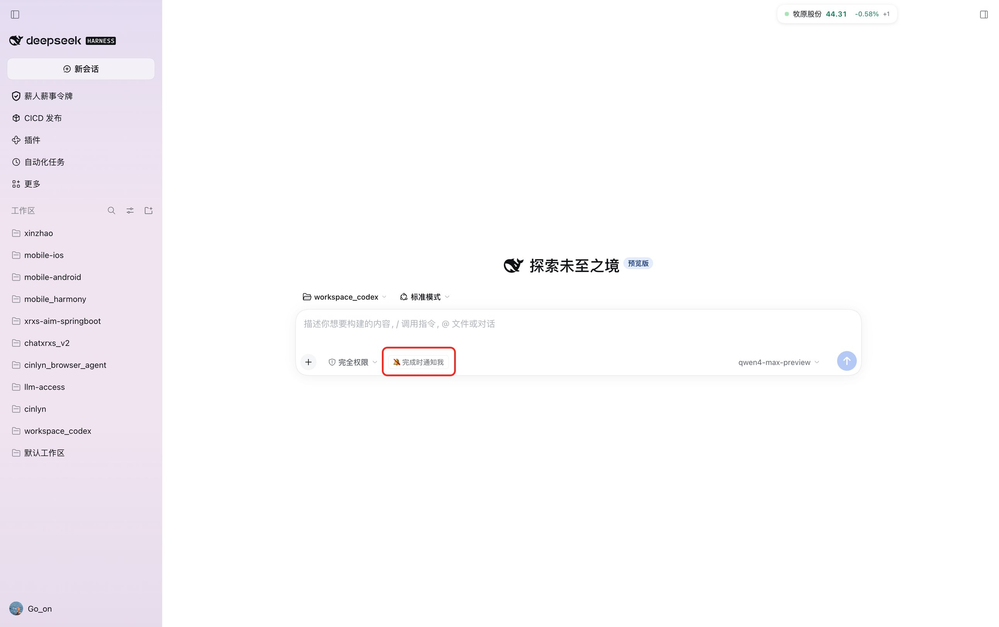
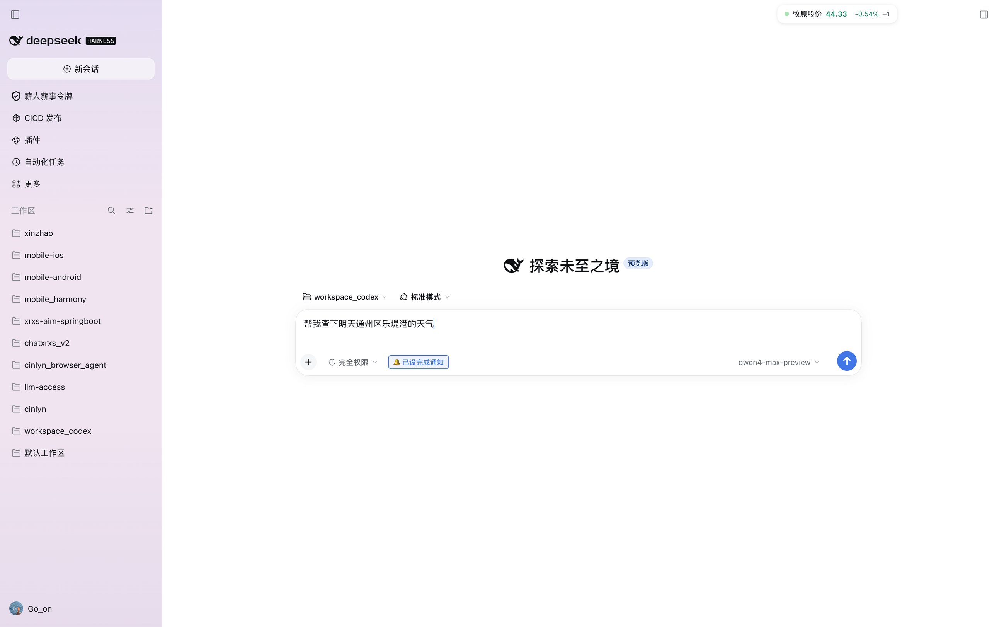

# DSH 任务完成通知插件

**task-done-notify** — 一个 [DeepSeek Harness (DSH)](https://github.com/deepseek-ai/deepseek-harness) 插件：**每轮任务完成时、以及中途弹出需要你选择/批准的卡片时，自动弹 macOS 系统横幅**，跟 AI 说完任务就可以离开电脑——做完了它会叫你，卡住等你拿主意时它也会叫你。想要跨设备提醒时，再点亮输入框旁的铃铛，把这两种时刻的通知额外推到你手机上。

通知分两层，可在「插件 → 任务完成通知 → 配置」里分别开关与测试：

- **macOS 常驻横幅（默认开启，独立于铃铛）**：只要插件装着且通道开着，每个顶层会话回合结束（✅）、以及出现 `ask_user_question` 提问 / 计划确认 / 审批卡片等你回答时（⏳），就弹一条系统通知中心横幅，**无需点亮铃铛**。通知**以 DSH 应用自身的名义发出**——名字「DeepSeek Harness」、鲸鱼图标，**点击直达通知对应的会话**。详见[常驻通知](#常驻通知macos-横幅)。
- **手机推送（铃铛点亮后生效）**：下面三种方式按铃铛触发，**任务完成**和**等待你选择**两种时刻都会推送；等待推送**不消耗铃铛**（不熄灭 armed），任务真正完成时仍会再推一次完成通知并熄灭。

| 通知方式 | 触发 | 可用性判定 | 说明 |
|---|---|---|---|
| **macOS 常驻横幅** | 每轮完成 + 等待选择时自动（独立于铃铛） | DSH 桌面端（Electron） | 以 DSH 名义发的原生通知，鲸鱼图标；完成=会话名+回复摘要，等待=⏳+问题/待批准操作 |
| **微信（Server酱）** | 铃铛点亮 | 填了 SendKey 即可用 | 微信公众号推送，链路独立于钉钉，免费版每天 5 条 |
| **钉钉群（自定义机器人）** | 铃铛点亮 | 填了 Webhook 地址即可用 | 推到你指定的钉钉群，正文带安全关键词并 @ 你 |
| **钉钉（dws 发给自己）** | 铃铛点亮 | `dws contact user get-self` 成功即已登录 | 用本机 `dws` CLI 以你的钉钉账号给自己发一条消息，无需任何地址配置 |

## 界面

输入框工具行左侧的铃铛就是开关——灰色「完成或需选择时通知我」表示没开，蓝色「已设完成/等待通知」表示本轮的完成与等待选择时刻都会推送。

**未开启**：显示「完成时通知我」：



**已开启**：变成蓝色「已设完成通知」，本轮结束即推送：



## 为什么做这个

长任务经常一跑十几分钟，人早就去别处了。DSH 桌面端的完成没有任何跨设备提醒，而实测发现：

- **桌面钉钉在线时，手机钉钉不弹推送**（钉钉多端策略；自聊消息、群 @、应用内 DING 在此状态下均未触发手机推送）；
- 微信官方 iLink Bot API 需要 `context_token`（只能从用户先发的消息获得，没有冷启动推送能力），做单向通知太重；
- **Server酱**（微信公众号推送）和**钉钉群自定义机器人**是成本最低、链路最稳的两条通路 —— 于是做成插件，多通道并行，用哪条、开哪条由你决定。

## 常驻通知（macOS 横幅）

这是插件的默认能力：**装上就生效，不用点铃铛**。每个顶层会话回合结束，macOS 通知中心就弹一条横幅，告诉你"哪个会话的任务做完了"。

**以 DSH 的名义发**：macOS 通知的名字和图标取决于"哪个进程发的"。早期版本用 `osascript` 发，系统认它是"脚本编辑器"，图标换不掉。现在改为**在 DSH 桌面端（Electron）的渲染进程里调 `Notification` API**——通知由 DSH 应用自身发出，因此：

- 名字是「DeepSeek Harness」，图标是 DSH 鲸鱼；
- 用的是 DSH 自己的通知权限，**点击通知不仅聚焦 DSH 窗口，还会自动切换到通知对应的会话**（经官方 `ctx.uiWorkspace.openSession(sessionId)` 导航面，与定时任务插件打开关联会话同款机制）；
- 不依赖任何外部工具（不需要 terminal-notifier / osascript）。

**触发与防刷屏**：客户端订阅 Host 转发的 `api-session/status` 事件，某个会话从运行中（`running=true`）变为空闲（`running=false`）即一轮结束。只对 Host 会话列表里的**顶层会话**弹；子代理（`origin === 'subagent'`）回合不弹，避免一次任务里多个子代理收尾刷屏。

**等待选择也弹（v2.0.4）**：任务中途弹出 `ask_user_question` 提问、计划确认或审批卡片时，agent 仍在运行、回合并未结束——旧版此时不会有任何通知。现在 **Host 半区**以 `{ global: true, prepend: true }` 旁路观察 `user-questions/request` 与 `approval/request` 两个 waterfall（**同步 `next()` 放行，绝不拦截或改写官方卡片 UI**；必须 prepend——IM 类插件会抢先注册并挂起 `next()` 等待手机竞答，排它后面永远轮不到），检测到卡片后写入待弹队列；客户端每 2 秒经一次本地 RPC `waiting.poll` 取走队列，弹一条「⏳ 会话名 · 等待你的选择」横幅，正文是问题内容或待批准的操作。同一会话 30 秒内去重；等待横幅与完成横幅使用不同的通知 tag，互不覆盖。之所以不用客户端 waterfall 观察者：gateway 对每个转发请求只取第一个 settle 的监听器，且可能被其他消费者挂起，旁路观察在客户端不可靠。

**结合会话内容**：横幅不是固定文案——**标题是会话名**（`displayTitle`，持久标题，回退为项目名/短 id），**正文是本轮助手回复的内容摘要**。摘要取自 Host 的 `turnOutline` 投影末轮 `response`（已归一化、约 120 字封顶、排除工具结果与注入上下文）：客户端在回合结束后经一次本地 RPC `lastReply.get` 实时读取（`response` 在 `turn/end` 才落定，故不能在 `turn-stopping` 时取）。取不到回复时回退为「本轮已完成 · 时间」。

**权限**：首次发通知时 macOS 会弹系统授权框，允许「DeepSeek Harness」通知即可（授一次永久有效）。插件也会在加载时主动申请一次。若被拒绝，到「系统设置 → 通知 → DeepSeek Harness」重新允许；专注模式（勿扰）开启时横幅会被系统静默。

**开关**：设置页「macOS 横幅（DSH 名义）」卡片可关闭/开启，并发测试通知。开关状态存在本机凭据记录里，客户端实时读取。

## 功能

- 🖥️ **macOS 常驻横幅（独立于铃铛，以 DSH 名义）**：每个顶层会话回合结束、以及出现需要你选择/批准的卡片时自动弹通知中心横幅，鲸鱼图标；完成=会话名+回复摘要，等待=⏳+问题内容（每会话 30s 去重）；子代理回合不弹，避免刷屏。默认开启，可在设置页关闭或发测试；
- 🔔 **输入框工具行开关**（`conversation.input.left` 插槽）：点亮后 armed 态显示 DeepSeek 蓝（#4278EA，与发送按钮同色），用于额外的手机推送；
- 💬 **`/notify-when-done [on | off | status]`** 命令面：与按钮等效，且 **agent 运行中可随时 arm**（斜杠命令不走模型队列，不打断正在进行的工作）；
- 🎯 **完成一次性、等待不消耗**：手机推送在任务真正完成后自动熄灭；中途「等待你选择」的推送不熄灭 armed，处理完继续跑、完成时还会再推一次；macOS 横幅则两种时刻每次都弹；
- ⚙️ **设置页**（插件 → 任务完成通知 → 配置）：四种通知方式的开关、密钥填写/清除、**逐通道发送测试消息**，以及 dws 登录态实时展示；
- 🔐 **密钥只存本机凭据库**：写进 `~/.dsh/.credentials.yaml` 的凭据记录（owner-only 权限），配置文件里永远没有明文密钥；设置页只显示“已配置 + 掩码”，不回传原值；
- 🔄 **状态恢复**：页面刷新后铃铛状态通过 RPC 从 Host 读取权威状态自动恢复。

## 安装

### 前置准备（按需，用哪种配哪种）

1. **Server酱**：前往 [sct.ftqq.com](https://sct.ftqq.com) 微信扫码登录获取 SendKey，并在微信里关注其服务号；
2. **钉钉群机器人**：任意钉钉群 → 群设置 → 机器人 → 添加「自定义（通过 Webhook 接入）」，安全设置选**自定义关键词**（如 `进度通知`），复制 Webhook 地址；
3. **dws**：本机安装并登录 `dws`（钉钉官方 CLI）即可，无需额外配置。

以上三者都**不需要**手写配置文件——装好插件后在设置页里填、点测试即可。

### 安装插件

克隆本仓库到任意目录，然后在 DSH 的 Plugin Manager（侧栏「插件」）中从本地目录安装 `task-done-notify`；或通过 DSH 的插件管理工具执行：

```text
install_bundle target=<本仓库的绝对路径>
```

安装后 Client 半区通过 HMR 实时生效；**Host 半区代码变更需要 remove + install 才会加载新一代模块**。

### 配置项（可选）

`cordis.patch.yml` 里的 `config` 只放**默认值与非密钥**配置，正常情况下不用改：

| 字段 | 默认值 | 说明 |
|---|---|---|
| `serverchanKeyFile` | `~/.dsh/secrets/serverchan-sendkey.txt` | 兼容旧配置：凭据记录里没有 SendKey 时读这个文件 |
| `dingtalkWebhookFile` | `~/.dsh/secrets/dingtalk-webhook.txt` | 兼容旧配置：凭据记录里没有 webhook 时读这个文件 |
| `dingtalkAtMobiles` | `[]` | 钉钉 @ 的手机号默认值 |
| `dingtalkKeyword` | `进度通知` | 钉钉机器人安全关键词默认值 |
| `enableServerchan` | `true` | 首次安装时微信通道的初始开关 |
| `enableDingtalk` | `true` | 首次安装时钉钉群通道的初始开关 |
| `enableDws` | `false` | 首次安装时 dws 通道的初始开关 |
| `enableMacos` | `true` | 首次安装时 macOS 横幅通道的初始开关（独立于铃铛） |

> 设置页保存过的值优先于这里的默认值；凭据记录优先于旧的 `~/.dsh/secrets/*.txt` 文件。

## 使用

| 操作 | 方式 | 效果 |
|---|---|---|
| 开启 | 点铃铛，或 `/notify-when-done` / `/notify-when-done on` | 本轮任务完成、或中途需要你选择/批准时推送（完成时熄灭） |
| 运行中补开 | agent 正在工作时敲命令或点按钮 | 立即生效（命令不走模型队列，不打断工作） |
| 取消 | 再点一次按钮，或 `/notify-when-done off` | 立即熄灭 |
| 查状态 | `/notify-when-done status` | 显示是否已开启，以及会用到哪些通道 |

通知内容：
- **macOS 常驻横幅**：完成=标题「✅ 会话名」+ 本轮助手回复摘要（约 120 字，无回复时回退「本轮已完成 · 时间」）；等待=标题「⏳ 会话名 · 等待你的选择」+ 问题内容或待批准操作。
- **手机推送（铃铛）**：完成=标题「✅ DSH 任务完成」+ 会话标识 + 完成时间；等待=标题「⏳ DSH 等待你的选择」+ 会话标识 + 问题/操作 + 发起时间；钉钉群消息额外带 `【关键词】` 前缀并按配置 @ 手机号。

## 工作原理

```text
[Client 半区（浏览器）]                      [Host 半区（Node）]
输入框铃铛 / 设置页
  │ POST /api/task-done-notify ──────────→ connection.fetch 精确路由
  │ （同源 fetch，认证栅栏内）                arm / disarm / status
  │                                          settings.get / save / channel.test
  │                                                 │
（也可以走 /notify-when-done 命令 ────────→ commands.register 的 handler）
                                                    │
                                                    ▼ 监听 agent/turn-stopping
                                              armed 中含该会话？
                                                    │ 是 → 并行发送并熄灭
                                                    ▼
                                   Server酱 HTTP POST ──→ 微信横幅
                                   钉钉 webhook JSON ──→ 群消息 @
                                   dws CLI（execFile）──→ 钉钉自己的会话
```

> 等待推送走同一组通道：Host 以 `{global:true, prepend:true}` 旁路观察 `user-questions/request` 与 `approval/request` 两个 waterfall，armed 中含该会话即推「⏳ DSH 等待你的选择」；观察者同步 `next()` 放行，不熄灭 armed，每会话 30s 去重。同一观察还向横幅待弹队列投递一份（与铃铛无关）。

常驻 macOS 横幅独立于上图的铃铛链路：

```text
Host agent/status ──转发──→ api-session/status(sessionId, running)
Client ctx.remote.$on 订阅 ──→ running true→false 且为顶层会话？
      │ 是 → new Notification('✅ 会话名', 回复摘要)
      ▼
macOS 通知中心：DeepSeek Harness + 鲸鱼图标

Host 提问/审批 waterfall 旁路观察者（prepend，立即 next()）
      │ 入队 ──→ waiting.poll（Client 每 2s 一次本地 RPC，取走即清）
      ▼
Client 顶层会话且 30s 内未弹过？
      │ 是 → new Notification('⏳ 会话名 · 等待你的选择', 问题/操作)
      ▼
macOS 通知中心（与完成横幅不同 tag，互不覆盖）
```

利用的 DSH 扩展点：

- `conversation.input.left` 插槽 — 工具行铃铛；
- `plugins.row.config` 插槽 — 插件行配置页（「插件」管理页 → 本插件 → 配置）；
- `connection.fetch.register` — `/api/*` 包私有 RPC 路由（浏览器认证栅栏内）；
- `agent/turn-stopping` 事件 — Host 侧「本轮收尾」信号，驱动铃铛 armed 的完成推送；
- `user-questions/request` / `approval/request` waterfall — 提问与审批卡片到达的挂点；Host 以 `{global:true, prepend:true}` 注册**纯旁路观察者**（同步 `next()`，不改写不阻塞），驱动 armed 的「等待选择」手机推送，并向横幅待弹队列投递；Client 经 `waiting.poll` RPC 每 2s 取走队列弹 ⏳ 横幅（客户端 waterfall 只取第一个 settle，旁路观察不可靠，故不在 Client 挂）；
- `ctx.remote.$on('api-session/status')` — Client 侧订阅 Host 转发的会话运行状态，`running` true→false 即回合结束，驱动常驻 ✅ 横幅；
- `ctx.uiWorkspace.openSession(sessionId)` — 官方 UiWorkspace 导航面（schedule 插件打开关联会话同款用法），横幅点击时聚焦窗口并切换到通知对应的会话；
- `ctx.sessions.list` — Client 会话列表快照，用 `ids` 判定顶层会话、用 `byId[].displayTitle/origin` 取标题并过滤子代理；
- `ctx.sessionProjections.stateOf(session, 'turnOutline')` — Host 读末轮 `response` 预览作为横幅正文，经 RPC `lastReply.get` 提供给 Client；
- 渲染进程 `Notification` API — 在 Electron 桌面端发原生通知，归属 DSH 应用（名字 + 鲸鱼图标）；
- `commands.register` — 斜杠命令面；
- `ctx.credentials` 凭据记录 — `task-done-notify/settings`，密钥与 macOS 开关都不落配置文件。

## 已知边界

- **常驻横幅依赖 DSH 桌面端**：通知由渲染进程 `Notification` API 发出，需要 DSH 桌面端（Electron）在运行；纯浏览器 `dsh web` 场景下走浏览器通知权限，行为以浏览器为准。App 退出后不再发送；
- **需要 DSH 的系统通知权限**：首次发通知时 macOS 会弹授权框，允许「DeepSeek Harness」即可；若被拒绝，到「系统设置 → 通知 → DeepSeek Harness」重新允许。专注模式（勿扰）开启时横幅会被系统静默；
- **回合结束信号基于运行状态边沿**：插件重载瞬间若错过某回合的 `running=true`，该回合结束可能不弹（已用列表基线初始化尽量规避）；下一轮起正常；
- **等待通知覆盖提问与审批卡片**：`ask_user_question`（含计划确认）与工具审批（`approval/request`）都会触发；不覆盖第三方插件自绘的抽屉/面板（如 CICD 批量面板），那些不经过标准问答/审批 waterfall；同一会话 30s 内只提醒一次，连续多问不会刷屏；⏳ 横幅经 2s 轮询取队列，最多延迟约 2 秒；
- **等待推送也受 Server酱配额限制**：免费版每天 5 条，等待+完成都计数，长任务多轮提问时可能耗尽当日配额；
- DSH Desktop 进程退出后 Host 不在，手机推送无法发出（armed 状态也随进程清零）；
- Server酱 免费版每天 5 条，超出后当日静默（可换 PushPlus / WxPusher 同原理服务）；
- 钉钉两条通道在**桌面钉钉在线**时手机通常不弹推送（钉钉产品策略），更适合作为「电脑不在了」场景的兜底；日常提醒以微信通道为主；
- dws 通道依赖本机 dws 登录态，登录过期后设置页会显示「未登录」及原因；
- agent 空闲时 arm 只对「下一轮任务」生效——任务已经做完才 arm 是等不到通知的。

## 凭据安全

- 密钥保存在 `~/.dsh/.credentials.yaml` 的 `records.task-done-notify/settings` 下，文件为 owner-only 权限，由 DSH 凭据服务管理；
- 设置页只显示掩码，RPC 永不返回原值；
- 清除某个密钥时，如果 `~/.dsh/secrets/` 下仍有同名文件，旧文件会继续作为回落来源——想彻底移除就把文件也删掉。